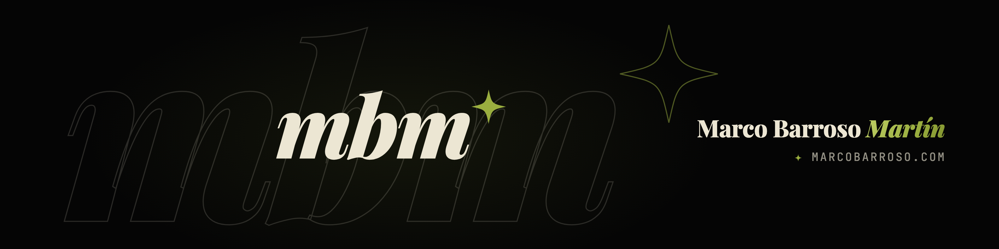

### Hi, I'm Marco 👋

Software Engineer at **laaabs.** and Computer Science and Engineering student at **UC3M** in Madrid.
I design and build complete products: native apps, full-stack web, LLM-based tools and code analysis.

### Selected work

| | |
|---|---|
| **[Rumies](https://github.com/marcoobarroso/rumies)** | Shared-flat app for expenses, chores and shopping. Native SwiftUI app (beta on TestFlight) and a Next.js web app on Supabase. |
| **[Priv8](https://github.com/aaangelmartin/Priv8)** | Privacy layer for AI agents that use screens: the model only sees tokens and real data stays on your device. HackFinanc€ 2026. |
| **[Argus](https://github.com/marcoobarroso/Argus)** | Static security analyser for Python built from scratch: own parser, control-flow graph and taint analysis, with explanations from Claude. |
| **[Open2Agents](https://open2agents.com)** | Shopify plugin that tells people, scrapers and AI shopping agents apart. Winner of Start Camp 2026. |
| **[HiveMind](https://marcobarroso.com/proyectos/hivemind.html)** | Real-time sync between developers and their AI assistants. Top 3 at the JetBrains × BEST UC3M hackathon. |
| **[Charanga Los Torreznos](https://charangalostorreznos.es)** | Website for a Madrid brass band, with instruments you can play in the browser. Client project. |

### Tools I use

`SwiftUI` `TypeScript` `Next.js` `React` `Python` `Kotlin` `Supabase` `PostgreSQL` `Tailwind CSS` `LLM APIs`

### Elsewhere

[marcobarroso.com](https://marcobarroso.com) · [LinkedIn](https://www.linkedin.com/in/marcobarrosomartin/) · [contacto@marcobarroso.com](mailto:contacto@marcobarroso.com)
